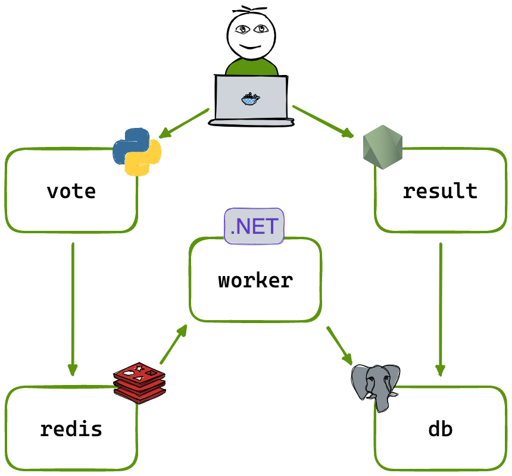

# Example Voting App: Tier 1 DevOps project

This fork extends the sample voting app into a tested, scanned, and automated
deployment on a single AWS server:

```text
browser -> vote (Python) -> Redis -> worker (.NET) -> PostgreSQL <- result (Node.js) <- browser
```

| Step | What this repository provides |
|---|---|
| 1. Run locally | Start the development stack with `docker compose up --build`; vote at <http://localhost:8082> and view results at <http://localhost:8081>. Run [`scripts/smoke-test.sh`](scripts/smoke-test.sh) to submit a vote and check the app endpoints; it can also verify the vote reached PostgreSQL. |
| 2. Test and scan | [`.github/workflows/ci-cd.yml`](.github/workflows/ci-cd.yml) runs vote unit tests and Helm chart lint/render checks. It builds the app images and scans them with Trivy; scans report findings but do not block by default. |
| 3. Build and deploy | Terraform provisions a single EC2 server and Elastic IP; Ansible installs the selected deployment mode (Compose, k3s with Helm, or both). The Terraform workflow uses remote S3 state with lock-file locking. Set `use_default_vpc = true` in Terraform variables to use the account's default VPC. |
| 4. CI/CD | On pushes to `main`, the workflow publishes the vote, result, and worker images to GHCR with the commit SHA and `latest` tags, then deploys the Helm release. The infrastructure and destroy workflows are [`.github/workflows/terraform.yml`](.github/workflows/terraform.yml) and [`.github/workflows/terraform-destroy.yaml`](.github/workflows/terraform-destroy.yaml). |
| 5. Operate | [`helm/voting-app/`](helm/voting-app) includes CPU autoscaling, Prometheus, and Grafana. Grafana is exposed on NodePort `31002`; the vote and result services use `31000` and `31001`. Inspect and roll back releases with `helm history voting` and `helm rollback voting`; [`scripts/rollback-demo.sh`](scripts/rollback-demo.sh) rehearses a failed release. |

AWS credentials and the SSH private key are supplied through GitHub Actions
secrets. Terraform generates the database password and Ansible provisions it
as a Kubernetes Secret or a protected Compose-server `.env` file. Keep the S3
state bucket private and encrypted; Terraform state contains sensitive values.

The manual setup steps and GitHub/AWS configuration are documented in
[`instruction.txt`](instruction.txt).

## Application overview

A small distributed voting application composed of Python, Node.js, .NET,
Redis, and PostgreSQL. The application demonstrates a vote frontend, an
asynchronous worker, and a live results frontend.

## Application architecture



- **Vote**: Python web application where users choose between two options.
- **Redis**: queue for newly submitted votes.
- **Worker**: .NET service that reads votes from Redis and writes them to
  PostgreSQL.
- **PostgreSQL**: persistent vote store.
- **Result**: Node.js application that displays the current results.

## Run locally with Docker Compose

Install [Docker Desktop](https://www.docker.com/products/docker-desktop), or
install Docker Engine and the Docker Compose plugin on Linux. From the
repository root, run:

```shell
docker compose up
```

The development Compose file builds the services locally. Open:

- Vote: <http://localhost:8082>
- Results: <http://localhost:8081>

To cast a vote and verify that it reaches PostgreSQL, run the smoke test from
the repository root:

```shell
VOTE_URL=http://localhost:8082 RESULT_URL=http://localhost:8081 \
DB_COUNT_CMD="docker compose exec -T db psql -U postgres -tAc 'select count(*) from votes'" \
scripts/smoke-test.sh
```

To run the pre-built Docker images instead:

```shell
docker compose -f docker-compose.images.yml up -d
```

The pre-built image deployment uses ports `8080` (vote) and `8081` (results).
To stop either deployment, run `docker compose down`.

## Single-tier AWS deployment with Terraform and Ansible

This repository includes a one-tier AWS deployment intended for a lab,
demonstration, or small non-production environment. Terraform creates one
Ubuntu EC2 instance in one public subnet and assigns it an Elastic IP.
Ansible installs Docker and deploys the selected mode: Docker Compose,
single-node k3s with Helm, or both.


The deployment consists of:

```text
Internet
   |
Elastic IP
   |
VPC -> public subnet -> EC2 instance
                          ├── vote
                          ├── result
                          ├── worker
                          ├── Redis
                          └── PostgreSQL + persistent Docker volume
```

The Compose service URLs are:

- Vote page: `http://<elastic-ip>:8080`
- Results page: `http://<elastic-ip>:8081`

For k3s, the vote and result services use NodePorts `31000` and `31001`.
Grafana is available on NodePort `31002`.

The security group exposes only the configured application ports and SSH.
Redis (`6379`) and PostgreSQL (`5432`) remain internal to the server. The
same Terraform configuration can deploy Docker Compose, single-node k3s with
the Helm chart in [`helm/voting-app/`](helm/voting-app), or both. Set
`use_default_vpc = true` in the Terraform variables to use the account's
default VPC instead of creating a dedicated VPC.

### Prerequisites

Install and configure:

- An AWS account and credentials available to the AWS provider.
- Terraform `>= 1.10.0` (required for S3 lock-file state locking).
- An existing EC2 key pair, or a public key if
  `create_key_pair = true`.
- Ansible Core on the machine running Terraform:
  `pipx install ansible-core`.

The configured AWS region defaults to `eu-north-1`. The AMI filter currently
targets Canonical Ubuntu 24.04 x86_64 images; change
`ami_name_filter` in [`terraform/terraform.tfvars`](terraform/terraform.tfvars)
if the selected region does not provide that image.

The Terraform backend uses an existing S3 bucket configured in
[`terraform/backend.tf`](terraform/backend.tf). Create that bucket first, or
change the backend configuration to a bucket you control. Enable bucket
versioning and encryption, block public access, and do not commit AWS
credentials, private keys, or Terraform state.

### Deploy

1. Review the values in [`terraform/terraform.tfvars`](terraform/terraform.tfvars).
   In particular, set `key_name`, `ssh_private_key_path`, and restrict
   `ssh_allowed_cidrs` to your own administration network where possible.
2. Initialize and validate Terraform:

   ```shell
   cd terraform
   terraform init
   terraform fmt -check
   terraform validate
   ```

3. Review and apply the plan:

   ```shell
   terraform plan
   terraform apply
   ```

   `run_ansible = true` causes Terraform to generate the Ansible inventory and
   variables, wait for SSH, and deploy the selected Compose and/or k3s mode.
   The k3s setup installs Helm, provisions the database Secret, installs the
   chart, and checks that the web applications respond.

4. Print the URLs and connection details:

   ```shell
   terraform output
   ```

   Useful outputs include `vote_url`, `result_url`, `public_ip`, and
   `ssh_command`.

Set `deploy_method` to `"compose"`, `"k3s"`, or `"both"` to choose the
deployment mode. The repository's current Terraform variables select `"both"`;
if you expose both deployments, they use different ports.

### Re-running Ansible

Terraform normally runs Ansible when the server, deployment method, images, or
deployment files change. To run it manually after changing the generated
variables:

```shell
cd ansible
ansible-playbook playbook.yml -e @vars.generated.yml
```

The generated files `ansible/inventory.ini` and
`ansible/vars.generated.yml` are local deployment artifacts and should not be
committed.

### Remove the AWS resources

When the environment is no longer needed, destroy the resources to avoid
ongoing AWS charges:

```shell
cd terraform
terraform destroy
```

### Scope and production limitations

This is deliberately a **single-tier** deployment, not a highly available
production architecture. It has one EC2 instance, one Availability Zone, a
publicly reachable host, and PostgreSQL data stored on the instance's EBS
volume. It does not provide an Application Load Balancer, managed RDS,
multi-AZ failover, node autoscaling, backups, TLS termination, or
zero-downtime deployments. The Helm chart can autoscale the vote and result
pods, but that does not scale the single EC2 host. Add the missing services
and controls before using the design for production workloads.

## Run the app in Docker Swarm

Initialize a swarm if necessary:

```shell
docker swarm init
```

Deploy the stack:

```shell
docker stack deploy --compose-file docker-stack.yml vote
```

## Run the app in Kubernetes

The [`k8s-specifications/`](k8s-specifications) directory contains Kubernetes
Deployments and Services for the voting app:

```shell
kubectl apply -f k8s-specifications/
kubectl get pods
kubectl get svc
```

The vote app is available on port `31000` and the results app on port `31001`
when the services are exposed through their configured NodePorts.

Remove the resources with:

```shell
kubectl delete -f k8s-specifications/
```

## Run the app with Helm

This repository includes a Helm chart at [`helm/voting-app/`](helm/voting-app)
for deploying the application on a Kubernetes cluster. The chart creates the
vote, result, worker, Redis, and PostgreSQL workloads and exposes the apps
through NodePorts by default. The vote app uses port `31000` and the results
app uses port `31001`. Prometheus collects metrics inside the cluster, and
Grafana is exposed on NodePort `31002`.

### Prerequisites

- A Kubernetes cluster with `kubectl` configured to the target cluster.
- Helm 3 installed locally.
- The three application images pushed to a container registry.
- A database password Secret in the namespace where you will install the chart.
  Store the password in a protected file, then create the Secret:

```shell
kubectl create secret generic voting-db \
  --from-file=POSTGRES_PASSWORD=/secure/path/to/password-file
```

### Install

From the repository root, install or upgrade the `voting` release. Replace
`YOUR_GITHUB_USERNAME` with the registry owner that contains the images:

```shell
helm upgrade --install voting ./helm/voting-app \
  --set image.registry=ghcr.io/YOUR_GITHUB_USERNAME \
  --set image.tag=latest \
  --set db.existingSecret=voting-db
```

The chart expects these image names under the registry path:

- `example-voting-app-vote`
- `example-voting-app-result`
- `example-voting-app-worker`

For example, the vote image would be
`ghcr.io/YOUR_GITHUB_USERNAME/example-voting-app-vote:latest`.

### Verify

```shell
kubectl get pods
kubectl get svc
```

Open `http://<server-ip>:31000` for voting and
`http://<server-ip>:31001` for results, substituting the IP address of a
Kubernetes node that is reachable from your machine.

To manage the k3s cluster directly on the EC2 server, connect with SSH and
configure the k3s kubeconfig before running the `sudo -E helm` commands below.
The install command above can instead be run from your machine if its
`kubectl` context targets this cluster.

```shell
ssh -i ~/.ssh/devop-aws-ssh.pem ubuntu@SERVER_IP
export KUBECONFIG=/etc/rancher/k3s/k3s.yaml
sudo -E helm list -A
```

Replace `SERVER_IP` with the EC2 server's public IP address.

### Roll back or uninstall

```shell
sudo -E helm history voting
sudo -E helm rollback voting REVISION
sudo -E helm uninstall voting
```

Replace `REVISION` with a revision shown by `helm history`. When using a locally
configured Kubernetes context instead of SSHing to the k3s server, run these
Helm commands without `sudo -E`.

## Monitoring with Prometheus and Grafana (k3s / Helm only)

The Helm chart installs Prometheus and Grafana by default
(`monitoring.enabled: true` in `helm/voting-app/values.yaml`). Monitoring is
available only with the k3s/Helm deployment; Docker Compose does not include
Prometheus or Grafana.

Prometheus scrapes five jobs:

| Job | Metrics |
|---|---|
| `redis` | Votes waiting in the queue, clients, memory, and commands |
| `postgres` | Stored votes, connections, and transactions |
| `containers` | Container CPU, memory, and network metrics from kubelet/cAdvisor |
| `grafana` | Grafana health |
| `prometheus` | Prometheus health |

The vote, result, and worker applications do not currently expose application
metrics, so request counts and latencies are not available.

### Open Grafana and get the password

Open `http://<server-ip>:31002` (or use the `grafana_url` Terraform output).
Sign in with username `admin`. The Helm chart generates the password on its
first install and stores it in the Kubernetes Secret `grafana-admin`; upgrades
reuse that password. It is not stored in Git. Retrieve it from the k3s server:

```shell
ssh -i ~/.ssh/devop-aws-ssh.pem ubuntu@SERVER_IP
sudo k3s kubectl get secret grafana-admin \
  -o jsonpath='{.data.admin-password}' | base64 --decode; echo
```

Replace `SERVER_IP` with the server's IP. Keep the decoded password private.
In Grafana, open **Dashboards > Voting app > Voting app**.

### Check Prometheus and the dashboard

Prometheus is internal to the cluster and is not exposed publicly. To inspect
its scrape targets, open an SSH tunnel from your local machine:

```shell
ssh -i ~/.ssh/devop-aws-ssh.pem -L 9090:localhost:9090 ubuntu@SERVER_IP
```

In that SSH session, start a port-forward:

```shell
sudo k3s kubectl port-forward svc/prometheus 9090:9090

# OPEN THE SECURITY GROUP AND ADD 9090
```

Then open <http://localhost:9090/targets> locally and check that all five jobs
are `UP`. Cast votes at `http://<server-ip>:31000` and watch the Grafana
dashboard for vote and resource metrics; it refreshes every 10 seconds.

### Monitoring notes and troubleshooting

- Prometheus retains three days of metrics in pod-local storage. Metrics are
  lost if the Prometheus pod is replaced or restarted.
- There is no alerting or identity-provider integration.
- If the `containers` target is down, inspect Prometheus logs with
  `sudo k3s kubectl logs deploy/prometheus`; authorization errors can indicate
  Kubernetes permissions, while certificate errors relate to kubelet TLS.
- If a panel shows no data, inspect its query in Grafana **Explore**. The
  stored-vote row count depends on the PostgreSQL exporter metric; the
  "Votes written to Postgres per second" panel is a more reliable indicator.
- To disable monitoring for an install or upgrade, use
  `--set monitoring.enabled=false` with `helm upgrade`.

## Notes

The voting application accepts one vote per client browser. Additional votes
from the same browser are ignored.

This is an educational example of a distributed application and is not
intended to be a complete production architecture.
